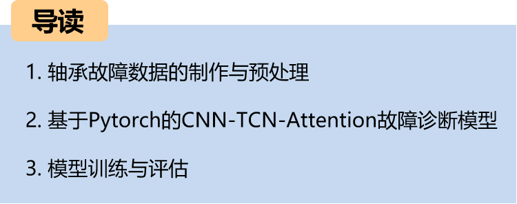
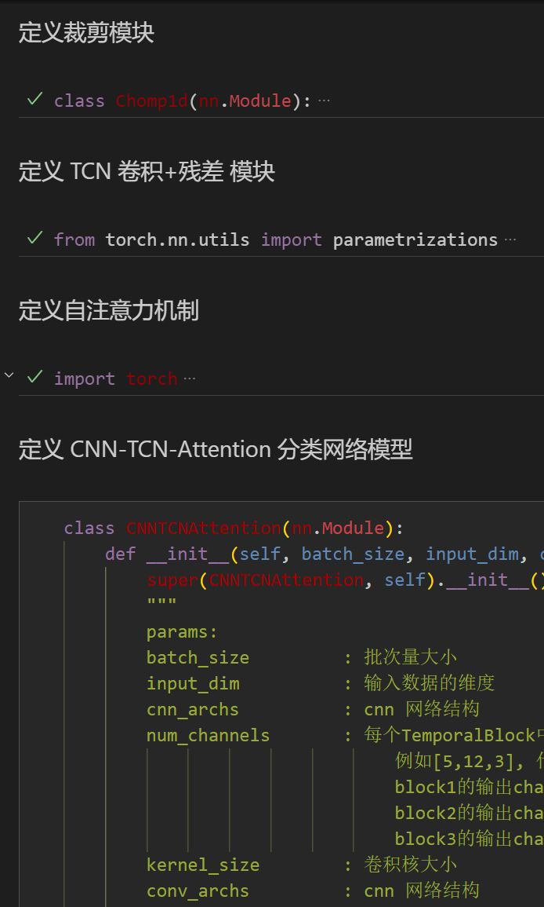
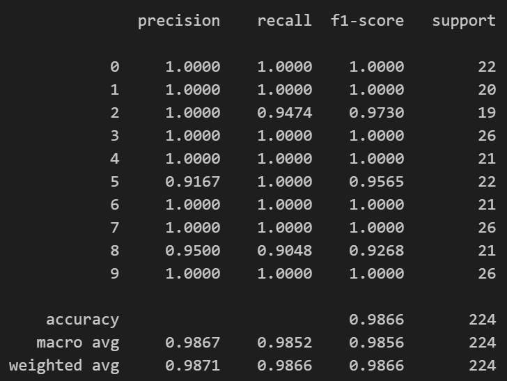
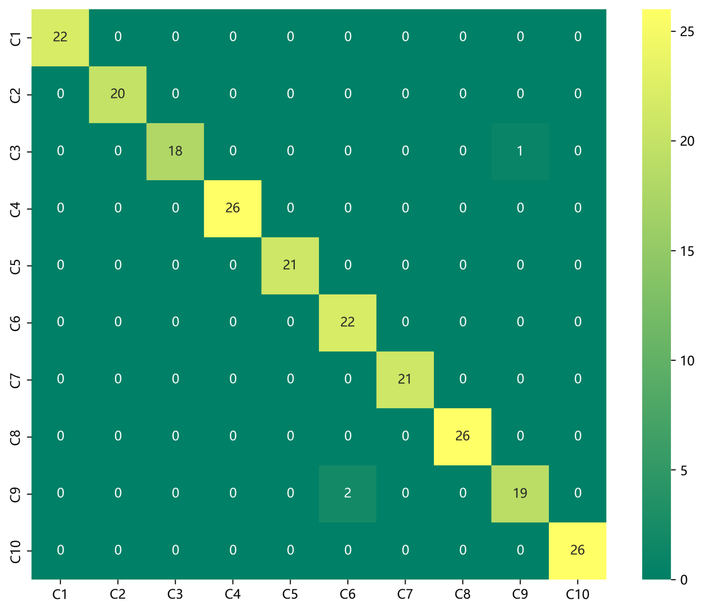
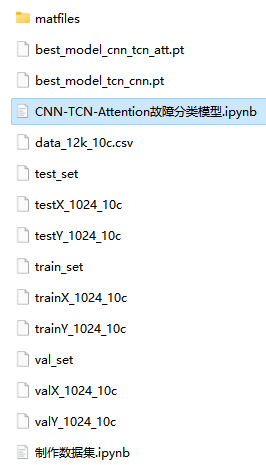

# Python Bearing Fault Diagnosis (18) - Innovative Diagnosis Model Based on CNN-TCN-Attention

The dataset includes a complete CWRU bearing fault dataset, as well as the fault signal dataset, classification data, and label set that have been generated. The corresponding codes can be run.
The innovative network classification effect is significant, the model can fully extract the spatial and temporal features and frequency domain features of bearing fault signals, converges quickly, has excellent performance and high accuracy. Innovation is also there!!!
Environment: Python 3.9 PyTorch 1.8 and above are all acceptable.
\n        \n  
CNN-TCN-Attention innovative diagnostic model: input data dimension is [32, 1, 1024], firstly feed into CNN network for 1D convolutional pooling to extract spatial features, then feed the convolutional pooling features into TCN layer to extract temporal features, finally fuse multi-scale features through self-attention and finally feed into fully connected layer and softmax for classification diagnosis.

Preface:
This paper is based on CWRU bearing data, firstly preprocessed data to make and load dataset, and finally realized the classification of fault data by CNN-TCN-Attention model through Pytorch. The detailed introduction of CWRU bearing data can refer to the following article:
Python-CWRU Bearing Data Interpretation and Classification Processing
1. Bearing data loading and preprocessing:
1.1 Import data
Refer to previous articles for preprocessing of fault 10 classification, CWRU bearing data 10 classification dataset:
train_set, val_set, test_set are divided according to 7:2:1 training set, validation set, test set, finally save data.
The above figure is the form of data reading and preprocessing idea.
1.2 Data preprocessing, making dataset:
3. Based on Pytorch's CNN-TCN-Attention innovative diagnostic model:
3.1 Define CNN-TCN-Attention classification network model:
3.2 Set parameters, train the model:
50 epochs, accuracy nearly 98%, CNN-TCN-Attention network classification effect is significant, CNN-TCN-Attention model can fully extract bearing fault signal multi-scale features, convergence speed is fast, performance is particularly excellent, effect is obvious.
Note to adjust parameters:
1. Increase the number of TCN layers and the dimensions per layer, fine-tuning the learning rate;
2. Tune the number of CNN layers and the number of neurons per layer, increasing more epochs (note to prevent overfitting);
3. Change the shape of one-dimensional signal stacking (set appropriate length and dimension);
4. Model evaluation:
   - Accuracy, Precision, Recall, F1 Score
   - Classification confusion matrix for fault classification:
5. Previously excellent content:
   - Python-Kansas Wesleyan University (CWRU) bearing data interpretation and classification processing
   - Python bearing fault diagnosis (I) Short-time Fourier Transform STFT
   - Python bearing fault diagnosis (II) Continuous Wavelet Transform CWT
   - Python bearing fault diagnosis (III) Empirical Mode Decomposition EMD
   - Pytorch-LSTM bearing fault one-dimensional signal classification (I)
   - Pytorch-CNN bearing fault one-dimensional signal classification (II)
   - Pytorch-Transformer bearing fault one-dimensional signal classification (III)
   - Python bearing fault diagnosis (IV) Based on EMD-CNN fault classification
   - Python bearing fault diagnosis (V) Based on EMD-LSTM fault classification
   - Python bearing fault diagnosis (VI) Based on EMD-Transformer fault classification
   - Python bearing fault diagnosis (VII) Based on EMD-CNN-LSTM fault classification
   - Python bearing fault diagnosis (VIII) Based on EMD-CNN-GRU parallel model fault classification
   - Bearing fault identification model based on FFT + CNN - BiGRU-Attention attention on time and frequency domain features fusion
   - Bearing fault identification model based on FFT + CNN - Transformer time and frequency domain feature fusion
Python Bearing Fault Diagnosis (IX) VM-D+CNN-BiLSTM for Fault Classification
Python Bearing Fault Diagnosis (X) VM-D+CNN-Transformer for Fault Classification
Python Bearing Fault Diagnosis (11) VM-D+CNN-BiGRU-Attenion for Fault Classification
FFT + CNN - BiLSTM-CrossAttention Bearing Fault Identification Model with Cross Attention Fusion of Time and Frequency Features
FFT + CNN-Transformer-CrossAttention Bearing Fault Identification Model with Cross Attention Fusion of Time and Frequency Features
Introduction to Python Bearing Fault Diagnosis
Python Bearing Fault Diagnosis (13) Super-strong Machine Learning Recognition Model Based on Fault Signal Feature Extraction
Python Bearing Fault Diagnosis (14) Highly Innovative Fault Recognition Model

## Images

<!-- PAYMENT_BLOCK -->

## Get this dataset

- Payment link (Stripe): [Buy now](https://buy.stripe.com/3cs8yP7sY87d0vu9AB)
- Payment QR code: 

<!-- /PAYMENT_BLOCK -->
